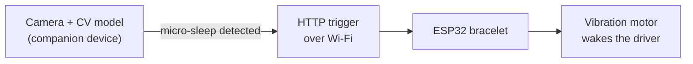

# MinAvto — AI Anti-Sleep Bracelet for Drivers

MinAvto is a wearable concept that stops drowsiness-related driving accidents: a camera and a computer-vision model detect signs of micro-sleep, and a wrist device wakes the driver with vibration before an accident can happen. It took **1st place at Enactus Kazakhstan** — and it was my first hardware project.

## How it works

The detection side watches for signs of micro-sleep — eyes closing, head dropping. When it fires, it calls the bracelet over the network, and the ESP32 drives the vibration motor on the driver's wrist.

## The bracelet firmware

This repo holds the bracelet's **alert firmware** — a lightweight ESP32 that connects to Wi-Fi and exposes two HTTP endpoints so the detection side can trigger the alert:

- `GET /start_vibration` → motor on
- `GET /stop_vibration` → motor off

It's deliberately minimal: the device is a wrist actuator, and the intelligence lives in the detection model. I built two MVP models over the course of the project.

## Hardware
- ESP32-WROOM
- Vibration motor + transistor driver
- 3D-printed enclosure and strap
- A companion computer runs the computer-vision model

## Tech
`C/C++` · `ESP32` · `Computer Vision` · `Wi-Fi / HTTP` · `Arduino`

## Recognition
🥇 **1st place, Enactus Kazakhstan**

---

*Built on the same ESP32 wearable platform as **Undeme**, a personal-safety wearable.*
